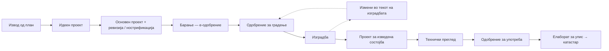
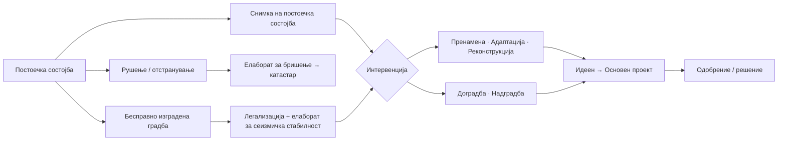

# Преглед на постапка — планирање, градење, употреба

Карта за навигација: **кој режим важи за една градба** и **по кој редослед** се оди од план до запишување. Не толкува — ги именува членовите каде што е барањето. Барањата се во членовите; кога картата и членот се разликуваат, важи членот.

> [!info] Потекло
> Обновена 2026-10-06 од картата на регулативниот режим во студискиот `ПРОЦЕС.canvas`, по губењето на претходната белешка со истото име при обновата на `40 CODES` (2026-08-31). Членовите се поврзани според поднасловите во [[ГР-01 - консолидиран|Закон за градење]]; содржината на секоја гранка треба да се провери против членот пред да се примени на проект. Студискиот процес што ја користи оваа карта: [[00 Delivery Stages]].

## 1. Категорија и надлежен орган

- **Категорија на градба** — прва или втора: [[ГР-01-Член 57]].
- **Надлежен орган** за одобрение за градење: [[ГР-01-Член 58]] — за прва категорија министерството, за втора општината (според картата; точната поделба е во членот).

## 2. Нова градба

| Чекор                                    | Членови                                                                                                                  |
| ---------------------------------------- | ------------------------------------------------------------------------------------------------------------------------ |
| Идеен проект                             | [[ГР-01-Член 45-а]]; кога се доставува на одобрување — [[ГР-01-Член 48-а]]                                               |
| Основен проект                           | [[ГР-01-Член 47]], [[ГР-01-Член 48]]                                                                                     |
| Ревизија / нострификација                | извештај за ревизија — [[ГР-01-Член 59]] ст.(2); нострификација — [[ГР-01-Член 55]]                                      |
| Барање и постапка                        | [[ГР-01-Член 59]] (документација, рокови, е-одобрение) и следните членови од „Постапка за издавање одобрение за градење“ |
| Измени во текот на изградбата            | [[ГР-01-Член 69]]; образец — [[ГР-05 - консолидиран\|ГР-05]]                                                             |
| Градилиште и документација на градилиште | [[ГР-01-Член 82]]–85, [[ГР-01-Член 86]]                                                                                  |
| Проект за изведена состојба              | [[ГР-01-Член 51]]                                                                                                        |
| Технички преглед                         | [[ГР-01-Член 89-а]]–92                                                                                                   |
| Одобрение за употреба                    | [[ГР-01-Член 88]], 93–94                                                                                                 |
| Примопредавање                           | [[ГР-01-Член 95]]                                                                                                        |
| Упис во јавна книга                      | [[ГР-01-Член 96-а]], [[ГР-01-Член 96]]; катастар — [[ГК-01 - консолидиран\|ГК-01]]                                       |

## 3. Градби за кои не е потребно одобрение за градење

Листата е во [[ГР-01-Член 73]] (огради, потпорни ѕидови, помошни градби до 50 м² на иста парцела, настрешници, базени за индивидуална употреба и др.). 
За нив општината издава **решение за изведување** — [[ГР-01-Член 74]]; барање и документација — [[ГР-04 - консолидиран\|ГР-04]].

*Во `ПРОЦЕС.canvas` оваа гранка се викаше „решение за градење“; законскиот термин е **решение за изведување**.*

## 4. Постоечка градба

| Гранка | Членови |
|---|---|
| Употреба, пренамена, адаптација, реконструкција | [[ГР-01-Член 97-а]]–[[ГР-01-Член 97\|97]] |
| Доградба и надградба | се градење во смисла на [[ГР-01-Член 2]] — иста постапка како за нова градба |
| Отстранување на градба | [[ГР-01-Член 99-а]]–[[ГР-01-Член 101\|101]] |
| Бесправно изградени градби | [[БО-01 - консолидиран\|Закон за постапување со бесправно изградени објекти]] |
| Бришење / упис во катастар | [[ГК-01 - консолидиран\|ГК-01]] |

> [!warning] За проверка
> Кога е потребен **елаборат за докажување сеизмичка стабилност** во постапката за легализација, и кои интервенции бараат одобрение наспроти решение, картата ги прикажува по студиската пракса. Пред примена на проект — проверка во [[БО-01 - консолидиран\|БО-01]] и [[ГР-01-Член 97]].
